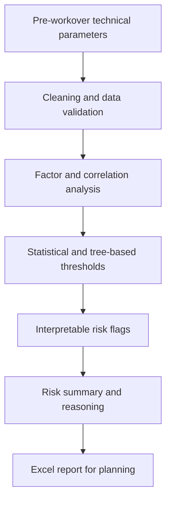

# Oilfield Risk Analytics
### Risk assessment of prolonged well workovers during conversion to pressure maintenance (ППД)

**Status:** research prototype and applied analytics case study  
**Role:** data analysis, algorithm design, technical interpretation, reporting  
**Stack:** Python · Pandas · NumPy · SciPy · scikit-learn · Jupyter · Excel

> Public portfolio description only. Proprietary datasets, well identifiers, internal economic figures, and source notebooks are not included.

## Problem

When converting production wells for reservoir pressure maintenance (ППД), capital workovers (КРС) may take longer than planned due to geological heterogeneity and the need for additional interventions. Decisions made during the workover can increase time and expenditure. The project investigates whether **pre-workover geological and technical parameters** can identify higher-risk cases before operations begin.

## Implemented analytical workflow

1. **Data preparation:** import tabular data, inspect missing values and numeric fields, examine outliers with IQR, export data-quality summaries.
2. **Factor analysis:** Spearman correlations, feature redundancy checks, feature ranking, and comparative classification models.
3. **Threshold analysis:** decision-tree-derived candidate thresholds, nonparametric comparisons, effect estimates and bootstrap-based assessment.
4. **Risk evaluation:** model comparisons for repair-duration prediction, interpretable threshold flags, an aggregated risk rule, explanatory columns, and Excel output.

The four existing Jupyter notebooks constitute the internal research implementation; they are **not published** in this repository.

## Process diagram

## Portfolio outcomes

- Developed an explainable workflow for pre-workover risk assessment using historical field data.
- Explored statistical, classification and regression approaches to identify influential variables.
- Produced threshold-based risk indicators with explanations designed to support engineering review.
- Documented a workover case comparing planned and actual scenarios, plus a modeled alternative.

**Important:** The underlying presentation describes pilot use and agreement between recommendations and past engineering decisions in reviewed cases; this is **not** an independently verified 100% out-of-sample accuracy claim. The economic scenario is modeled, not realized cost savings. Regression accuracy requires further validation.

## About the author

An engineer with production operations experience and training in data science and industrial software development. The case connects domain knowledge in well operations with statistical modeling and applied Python.

## Repository contents

- [`docs/methodology.md`](docs/methodology.md) — analytics pipeline and algorithm families
- [`docs/validation-and-limitations.md`](docs/validation-and-limitations.md) — interpretation, validation and disclosure limits
- [`docs/portfolio-summary-ru.md`](docs/portfolio-summary-ru.md) — Russian portfolio summary

**No production data, internal documentation or executable business algorithms are publicly disclosed here.**

---

## Кратко по-русски

**Программно-аналитический инструмент предварительной оценки рисков затяжного КРС при переводе скважин в ППД.** Проект на Python использует анализ геолого-технических параметров, корреляции Спирмена, статистические и древовидные пороги, флаги риска и пояснения в Excel-отчёте. Это исследовательский кейс, а не заявка на доказанную точность промышленного прогноза.
